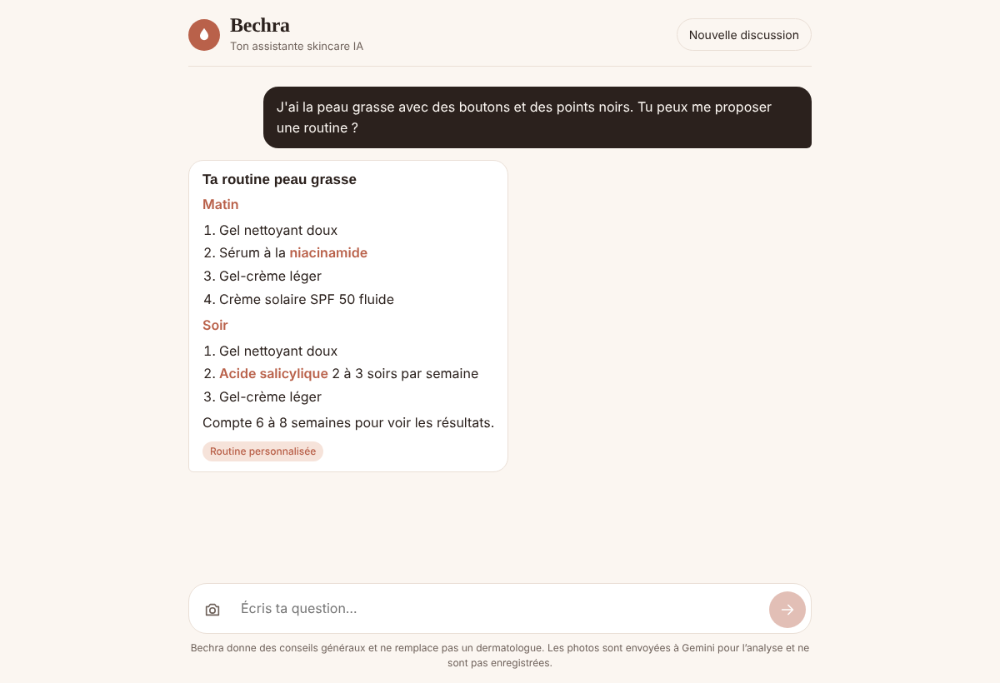

# Bechra — agent IA skincare

**Bechra** (« peau » en arabe) est une assistante IA qui aide à prendre soin de la peau du visage : routines matin et soir personnalisées, explication des ingrédients, compatibilité entre actifs, première observation à partir d'une photo, et orientation vers un dermatologue quand c'est nécessaire.

> Projet étudiant. Bechra donne des conseils généraux et ne remplace pas un avis médical.



## Fonctionnalités

- **Chat en langage naturel** en français, arabe ou derja tunisienne
- **Agent avec outils (function calling)** : Gemini décide lui-même quel outil appeler, puis rédige la réponse à partir du résultat
- **Analyse de photo** : observation prudente de ce qui est visible (brillance, rougeurs, imperfections), sans diagnostic
- **Sécurité** : détection des signes d'alerte (grain de beauté qui change, infection, réaction allergique) avec orientation vers un médecin ou les urgences
- Interface responsive, mode sombre automatique

## Architecture

```
React (Vite)  ──POST /api/chat──▶  Express (Node.js)  ──▶  Gemini API
   chat, photo                       boucle d'agent          (function calling)
                                          │
                                          ▼
                                 Outils locaux (tools.js)
                                 + base d'ingrédients (JSON)
```

À chaque message, le serveur envoie la conversation à Gemini avec la liste des outils. Si Gemini demande un outil, le serveur l'exécute, renvoie le résultat, et recommence jusqu'à obtenir la réponse finale (5 étapes maximum).

| Outil | Rôle |
|---|---|
| `build_skincare_routine` | Routine matin et soir selon le type de peau, les préoccupations, la grossesse et le maquillage |
| `get_ingredient_info` | Fiche d'un ingrédient : bienfaits, types de peau, mode d'emploi, précautions |
| `check_ingredient_compatibility` | Détecte les associations à éviter (ex. rétinol + AHA) et propose comment les répartir |
| `check_warning_signs` | Repère les symptômes qui justifient de consulter un dermatologue ou les urgences |

## Structure

```
bechra/
├── client/                  # React + Vite
│   └── src/App.jsx          # interface de chat, envoi de photo
├── server/                  # Node.js + Express
│   ├── src/index.js         # API REST
│   ├── src/agent.js         # boucle d'agent + prompt système
│   ├── src/tools.js         # outils appelés par Gemini
│   ├── src/data/ingredients.json
│   └── test/agent.test.js   # tests (client Gemini simulé)
└── package.json             # scripts globaux
```

## Installation

**Prérequis :** Node.js 20 ou plus, et une clé API Gemini gratuite sur [Google AI Studio](https://aistudio.google.com/apikey).

```bash
git clone https://github.com/<ton-utilisateur>/bechra.git
cd bechra
npm run install:all
cp server/.env.example server/.env   # puis colle ta clé dans GEMINI_API_KEY
```

Lancer en développement, dans deux terminaux :

```bash
npm run dev:server   # API sur http://localhost:3001
npm run dev:client   # interface sur http://localhost:5173
```

Lancer les tests :

```bash
npm test
```

## Déploiement

Le serveur Express sert aussi l'interface compilée, donc un seul service suffit (par exemple sur [Render](https://render.com), offre gratuite) :

- **Build command :** `npm run build`
- **Start command :** `npm start`
- **Variables d'environnement :** `GEMINI_API_KEY` (et `GEMINI_MODEL` si besoin)

## Technologies

React · Vite · Node.js · Express · Gemini API (`@google/genai`) · function calling · Node test runner

## Pistes d'amélioration

- Réponses en streaming
- Historique des conversations et profil de peau sauvegardés
- RAG sur des sources dermatologiques fiables
- Suivi de l'évolution de la peau avec des photos dans le temps
